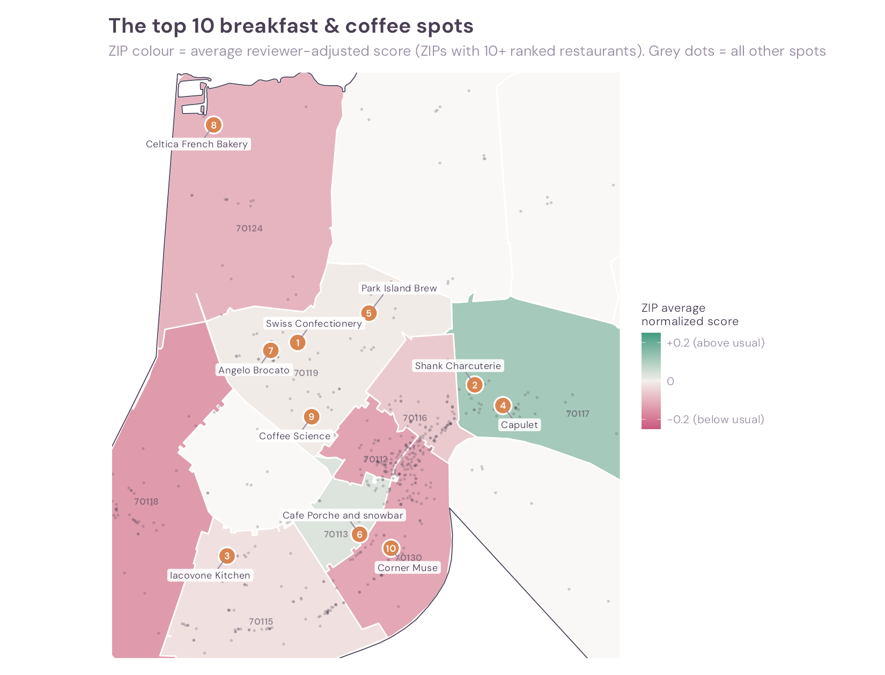
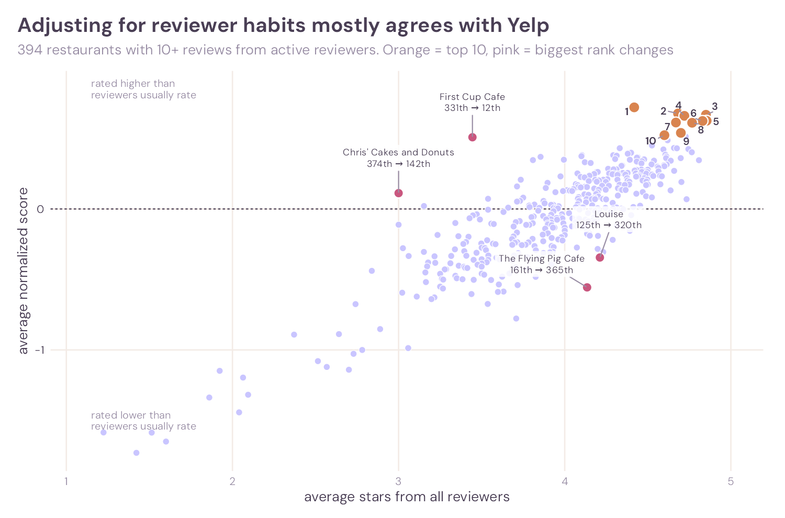

# Where’s the Best Breakfast in New Orleans?


*Math 167R · Project 2 · Yelp Open Dataset (reviews from 2005 to January
2022) · 575 breakfast & coffee restaurants · 159,552 reviews*

> **The one-sentence answer:** for the most reliable morning out, head
> just outside downtown. **Bywater & St. Roch (ZIP 70117)** is the best
> area overall, **Mid-City (70119)** has the most top-10 spots, and the
> top-ranked spot after adjusting for reviewer habits is **Swiss
> Confectionery** on Orleans Avenue.



| Rank | Restaurant | Neighbourhood (ZIP) | Yelp reviews | Average stars | Adjusted score | Rank on plain stars |
|---:|:---|:---|---:|---:|---:|---:|
| 1 | Swiss Confectionery | Mid-City (70119) | 55 | 4.42 | +0.72 | 70th |
| 2 | Shank Charcuterie | Marigny (70117) | 44 | 4.68 | +0.68 | 14th |
| 3 | Iacovone Kitchen | Freret (70115) | 40 | 4.85 | +0.67 | 2nd |
| 4 | Capulet | Bywater (70117) | 50 | 4.72 | +0.66 | 10th |
| 5 | Park Island Brew | Fairgrounds (70119) | 48 | 4.85 | +0.63 | 1st |
| 6 | Cafe Porche and snowbar | Central City (70113) | 176 | 4.83 | +0.62 | 3rd |
| 7 | Angelo Brocato | Mid-City (70119) | 650 | 4.67 | +0.61 | 16th |
| 8 | Celtica French Bakery | Lakeview (70124) | 30 | 4.77 | +0.61 | 5th |
| 9 | Coffee Science | Tulane-Gravier (70119) | 93 | 4.70 | +0.54 | 12th |
| 10 | Corner Muse | Lower Garden District (70130) | 55 | 4.60 | +0.52 | 26th |

*Adjusted score: how many stars above their own usual rating active
reviewers gave the restaurant (explained [below](#adjusting-for-reviewer-habits)).
“Rank on plain stars” is the same restaurant’s rank by ordinary Yelp
average among the 394 ranked restaurants.*

## What this project is about

New Orleans is famous for its breakfasts: beignets, brunch and chicory
coffee. But with one morning to spare, **where should you go?**

This project uses the Yelp Open Dataset to answer one question:

> **Where can someone find the best breakfast and coffee in New Orleans,
> and which area of the city is best for finding it?**

A plain star average has two problems. Some restaurants have only a
handful of reviews, and some reviewers give everything five stars while
others almost never do. So “best” here means:

1. **Rated well by reviewers who are hard to impress.** Each review is
   compared with that reviewer’s own usual rating (the *adjusted
   score*).
2. **Enough evidence.** A restaurant needs at least 10 reviews from
   active reviewers to be ranked.
3. **For areas:** lots of good options, and restaurants that are rated
   above reviewers’ usual more often than not.

## Key findings

**1. The best area is Bywater & St. Roch (70117).** Its restaurants
have the highest average Yelp stars of any ZIP code with at least 5
breakfast spots (4.11), and after
adjusting for reviewer habits it is still the top ZIP code with enough
data: 60% of its ranked restaurants beat their reviewers’ usual rating.
It holds 2 of the top 10 and 8 of the top 50.

**2. Mid-City (70119) is where the top picks are.** Four of the top 10,
including Swiss Confectionery and Angelo Brocato, are in 70119, more
than in any other ZIP code.

**3. Downtown has the most choice, not the best choice.** ZIP 70130
(Warehouse District and upper French Quarter) has 143 breakfast &
coffee spots, a quarter of the total. Its restaurants score *below*
their reviewers’ usual on average, even though it still has 9 of the
top 50.

**4. Adjusting for reviewer habits mostly agrees with Yelp, with a few
big exceptions.** Ranks before and after adjustment are strongly
related (rank correlation 0.83). But some restaurants move hundreds of
places: First Cup Cafe climbs from 331st to 12th, because active
reviewers rate it far higher (4.47 stars) than casual reviewers do.

**5. ZIP codes are the right way to divide the city for this
question.** Census tracts and city neighbourhoods split the restaurants
so finely that most areas have fewer than 5 breakfast spots, too few
for a reliable average.

## The data and how the large files were handled

The project uses two files from the [Yelp Open
Dataset](https://business.yelp.com/data/resources/open-dataset/): the
business file (113 MB, 150,346 businesses) and the review file
(**5.1 GB, 6,990,280 reviews**). The review file is too big to load into
memory at once, so:

- **Streaming import.** Both files are read with `jsonlite::stream_in()`
  100,000 records at a time. Each batch is cut down to the needed
  columns and to New Orleans restaurants before the next batch is read,
  so the full 5 GB file never sits in memory. Scanning all 7 million
  reviews took about 6 minutes.
- **Only what’s needed.** Only the business and review files are pulled
  out of the Yelp archive.
- **Small, compressed outputs.** Results are saved as `xz`-compressed
  `.rds` files. Review text is stored separately because it makes up
  most of the size: the review table without text is 15 MB, the text
  alone 71 MB.
- **Raw files stay local.** The raw JSON files are several gigabytes,
  more than GitHub allows. They are listed in `.gitignore` and can be deleted once the `.rds`
  files are saved.

Full log of row counts and run times:
[`import_log.txt`](data/new_orleans/import_log.txt).

## Choosing the restaurants

**New Orleans restaurants.** A business counts if `state` is `LA`, its
`city` is “New Orleans”, and its categories include “Restaurants”. That
gives **2,261** restaurants.

**Breakfast & coffee.** The category field was split into one row per
business and category. Four categories describe places you’d go for a
morning meal or a coffee break:

| Category | Restaurants |
|:---|---:|
| Breakfast & Brunch | 367 |
| Coffee & Tea | 208 |
| Cafes | 173 |
| Bakeries | 81 |

These four belong together: they often appear on the **same**
restaurant.

| Category pair | Restaurants with both |
|:---|---:|
| Breakfast & Brunch + Coffee & Tea | 85 |
| Cafes + Coffee & Tea | 75 |
| Breakfast & Brunch + Cafes | 65 |
| Bakeries + Coffee & Tea | 37 |
| Bakeries + Breakfast & Brunch | 32 |
| Bakeries + Cafes | 16 |

**Inclusion rule:** a restaurant qualifies if it has *at least one* of
the four categories. That gives **575 restaurants** in 25 postal ZIP
codes (24 Census ZIP areas), well above the required 10 restaurants in
7 areas.

All category counts:
[`category_counts.csv`](data/new_orleans/category_counts.csv).

## Joining the reviews

Reviews were filtered to the 575 selected restaurants (joined on
`business_id`) before any further analysis, instead of carrying all
476,565 New Orleans restaurant reviews forward. That leaves **159,552
reviews** from 97,950 different reviewers.

## Checking the city boundary

Yelp’s `city` field is just text typed by the business. To check it,
each restaurant’s latitude and longitude were matched to the official
city boundary from the U.S. Census (`tigris::places()`):

| Yelp city | Official place | Restaurants |
|:---|:---|---:|
| New Orleans | New Orleans | 564 |
| New Orleans | Elmwood | 2 |
| New Orleans | Harahan | 2 |
| New Orleans | Jefferson | 2 |
| New Orleans | Metairie | 2 |
| New Orleans | Terrytown | 2 |
| New Orleans | Kenner | 1 |

The 11 mismatches are restaurants with a New Orleans mailing address
that sit just outside the city limits in Jefferson Parish. They are real
nearby options, so they stay in the analysis.


## Choosing a geographic system

To compare areas, the city has to be divided up somehow. Three systems
were tested, and each restaurant was assigned to an area with a spatial
join (`st_within`):

- **ZIP Code Tabulation Areas** (ZCTAs), the Census version of ZIP codes;
- **Census tracts**, statistical areas built for population data;
- **Neighborhood Statistical Areas** (NSAs), the City of New Orleans’
  own planning neighbourhoods.

| Geographic system | Areas with a restaurant | Restaurants assigned | Unmatched | Smallest area | Largest area | Median per area | Areas with < 5 |
|:---|---:|---:|---:|---:|---:|---:|---:|
| ZIP codes | 24 | 575 | 0 | 1 | 143 | 6.5 | 9 (38%) |
| Neighbourhoods (NSAs) | 54 | 564 | 11 | 1 | 119 | 4 | 28 (52%) |
| Census tracts | 103 | 564 | 11 | 1 | 117 | 2 | 75 (73%) |

The 11 unmatched restaurants are the same 11 that fall outside the city
limits. Tracts and neighbourhoods only cover the city, so those 11 have
no area to land in.


**The choice: ZIP codes.**

- **Enough restaurants to compare.** Most tracts and neighbourhoods hold
  only a few breakfast spots, so their averages swing from 1.5 to 5
  stars because of a single restaurant. ZIP codes pool enough
  restaurants for the averages to mean something.
- **Easy to understand.** Anyone knows a ZIP code. Few people know their
  census tract number.
- **Nothing left out.** Every restaurant was matched to a ZIP code,
  including the 11 just outside the city.

**What ZIP codes hide.** ZIP codes are postal areas, not neighbourhoods,
and they vary a lot in size. 70130 alone covers the Warehouse District
and part of the French Quarter, so a great café and a tourist trap
share one average. The 9 ZIP codes with fewer than 5 breakfast spots (17
restaurants in total) are mapped but not ranked.


## Adjusting for reviewer habits

Some reviewers give almost every restaurant five stars; others rarely
do. A 4-star review means more from a tough reviewer than from an easy
one.

**Active reviewers.** A reviewer’s “usual” rating is only meaningful if
they have reviewed enough places. Reviewers with at least **5 reviews**
of breakfast & coffee restaurants were kept:

| Minimum reviews per reviewer | Reviewers kept | Share of reviewers | Reviews kept | Share of reviews | Restaurants ranked |
|---:|---:|---:|---:|---:|---:|
| 3 | 11,531 | 11.8% | 57,617 | 36.1% | 448 |
| **5** | **3,416** | **3.5%** | **30,918** | **19.4%** | **394** |
| 10 | 784 | 0.8% | 14,919 | 9.4% | 325 |

Most Yelp reviewers write only one review in this group, so only 3.5% of
reviewers qualify, but they wrote almost a fifth of all reviews. A
higher threshold gives each reviewer a better baseline but leaves fewer
restaurants with enough reviews to rank.

**The adjusted score.** For each active reviewer, their usual rating is
the **mean** of all their breakfast & coffee reviews. Each review is
then scored as *stars given − reviewer’s usual*. A reviewer who averages
3 stars and gives a restaurant 4 adds **+1**; a reviewer who averages
5 and gives 4 adds **−1**. A restaurant’s adjusted score is the average
over its active-reviewer reviews. It is *not* a new star rating: it
measures how much better than usual reviewers found the place.

The **mean** was chosen over the median as the baseline because ratings
are whole stars. With a median baseline, **49%** of reviews get an
adjusted score of exactly 0, which throws away most of the information.
With the mean, only 5% do. The typical active reviewer averages 4.0
stars, but the range is wide: from 2.9 (5th percentile) to 4.8 (95th).



**Biggest rank changes** (among the 394 ranked restaurants):

| Restaurant | ZIP | Average stars (all reviewers) | Average stars (active reviewers) | Rank before | Rank after |
|:---|:---|---:|---:|---:|---:|
| First Cup Cafe | 70125 | 3.44 | 4.47 | 331st | **12th** |
| Chris’ Cakes and Donuts | 70128 | 3.00 | 3.82 | 374th | 142nd |
| Rare Form | 70116 | 3.85 | 4.27 | 251st | 29th |
| Le Citron Bistro | 70130 | 3.81 | 4.10 | 260th | 38th |
| The Flying Pig Cafe | 70115 | 4.13 | 3.30 | 161st | **365th** |
| Louise | 70117 | 4.21 | 3.83 | 125th | 320th |
| Wakin’ Bakin’ | 70115 | 4.23 | 3.79 | 121st | 307th |
| Streetcar Cafe | 70130 | 4.39 | 4.19 | 74th | 259th |

The moves have two causes. **Reviewer behaviour:** First Cup Cafe’s
active reviewers rate it a full star higher than casual reviewers do,
and about half a star above their own usual rating. **Small samples:** most of these
restaurants have only 10 to 25 active-reviewer reviews, so a few
reviews can move them a long way. Ranks near the top should be read with
that in mind.

**By ZIP code** (ZIP codes with at least 10 ranked restaurants):

| ZIP | Main neighbourhoods | Ranked restaurants | Above reviewers’ usual | In top 10 | In top 50 | Average adjusted score |
|:---|:---|---:|---:|---:|---:|---:|
| 70117 | Bywater & St. Roch | 30 | **60%** | 2 | 8 | **+0.11** |
| 70113 | Central City | 10 | 70% | 1 | 2 | +0.03 |
| 70119 | Mid-City | 43 | 53% | **4** | 8 | −0.01 |
| 70115 | Uptown & Garden District | 62 | 53% | 1 | 7 | −0.02 |
| 70116 | French Quarter & Marigny | 39 | 54% | 0 | 4 | −0.06 |
| 70124 | Lakeview | 17 | 41% | 1 | 1 | −0.10 |
| 70130 | Warehouse District & upper French Quarter | 98 | 44% | 1 | **9** | −0.12 |
| 70112 | CBD & Tulane-Gravier | 33 | 42% | 0 | 2 | −0.13 |
| 70118 | Carrollton & Audubon | 31 | 45% | 0 | 4 | −0.14 |

70113 has the highest share above usual but only 10 ranked restaurants,
so **70117** is the best-supported answer: it leads on plain Yelp stars
*and* on the adjusted score.

## How sure is the top 10?

The top 10 depends on the choices above. Changing one choice at a time:

| Version | Restaurants still in the top 10 |
|:---|---:|
| Reviewers with 3+ reviews count as active | 6 of 10 |
| Reviewers with 10+ reviews count as active | 6 of 10 |
| Median baseline instead of mean | 8 of 10 |
| Restaurants need 20+ active-reviewer reviews | 3 of 10 |
| Plain Yelp average (no adjustment) | 5 of 10 |

The exact list is sensitive, mostly because many top restaurants are
small, with 10 to 20 active-reviewer reviews. The **area** answer is
steadier: in every adjusted version, Mid-City (70119) and Bywater &
Marigny (70117) together hold at least half of the top 10.

## Limitations

- **The data stops in January 2022.** Some restaurants may have closed
  or changed since then.
- **Yelp categories are broad.** “Cafes” and “Coffee & Tea” also tag
  gelato shops (Angelo Brocato) and sandwich counters (Shank
  Charcuterie), so a few top-10 spots are not classic breakfast places.
- **Active reviewers are a small group.** The adjusted score rests on
  3.5% of reviewers. Their tastes may differ from a typical visitor’s.
- **Small samples.** Restaurants need only 10 active-reviewer reviews to
  be ranked, so the exact order of the top 10 could change with more
  data.
- **ZIP codes are not neighbourhoods.** A ZIP code average mixes very
  different streets.

## Conclusion

For breakfast and coffee in New Orleans, the best area is **just outside
downtown**. Bywater & St. Roch (70117) has the highest ratings on both
measures, and Mid-City (70119) holds the most top-10 spots. Downtown
70130 has the most options, but its restaurants are, on average, rated
slightly below what their reviewers usually give. Adjusting for reviewer
habits mostly confirms Yelp’s ratings, but it lifts a few places loved
by tough reviewers (First Cup Cafe) and drops a few that only easy
reviewers rate highly. The practical lesson: a high star count from
hundreds of easy reviewers is weaker evidence than a good score from
people who are hard to impress.

## Repository contents

| File | What’s inside |
|:---|:---|
| [`R/import.R`](R/import.R) | Streams the Yelp JSON files, filters to New Orleans restaurants, saves `.rds` |
| [`R/clean.R`](R/clean.R) | Category counts, co-occurrence, inclusion rule, review join |
| [`R/analysis.R`](R/analysis.R) | City-boundary check and the ZIP code and census tract spatial joins |
| [`R/boundaries.R`](R/boundaries.R) | Saves the ZIP code and neighbourhood shapes used in the maps |
| [`R/neighborhoods.R`](R/neighborhoods.R) | Neighbourhood spatial join and the three-system comparison table |
| [`R/compare_systems.R`](R/compare_systems.R) | Area-size comparison plot and ZIP ratings chart |
| [`R/reviewers.R`](R/reviewers.R) | Reviewer baselines, adjusted scores, top 10 and robustness checks |
| [`R/maps.R`](R/maps.R) | All maps and the ZIP-level adjusted scores |
| [`R/theme.R`](R/theme.R) | Shared plot style |
| [`data/new_orleans/`](data/new_orleans/) | Summary tables (`.csv`) and the import log |
| [`data/boundaries/`](data/boundaries/) | ZIP code and neighbourhood boundary shapes |
| [`figures/`](figures/) | Every chart and map in this README |

### Reproducing the results

1. Download the **JSON** version of the [Yelp Open
   Dataset](https://business.yelp.com/data/resources/open-dataset/)
   (`Yelp-JSON.zip`, about 4 GB) and put it in `data/raw/`. No need to
   unzip it.
2. From the project folder, run the scripts in order:

``` bash
Rscript R/import.R            # ~6 minutes; streams the 5 GB review file
Rscript R/clean.R
Rscript R/analysis.R          # downloads Census boundaries with tigris
Rscript R/boundaries.R
Rscript R/neighborhoods.R
Rscript R/compare_systems.R
Rscript R/reviewers.R
Rscript R/maps.R
```

Packages: `jsonlite`, `dplyr`, `tidyr`, `stringr`, `lubridate`, `sf`,
`tigris`, `ggplot2`, `ggrepel`, `scales`, `viridis` (and optionally
`ragg` and `systemfonts`).
