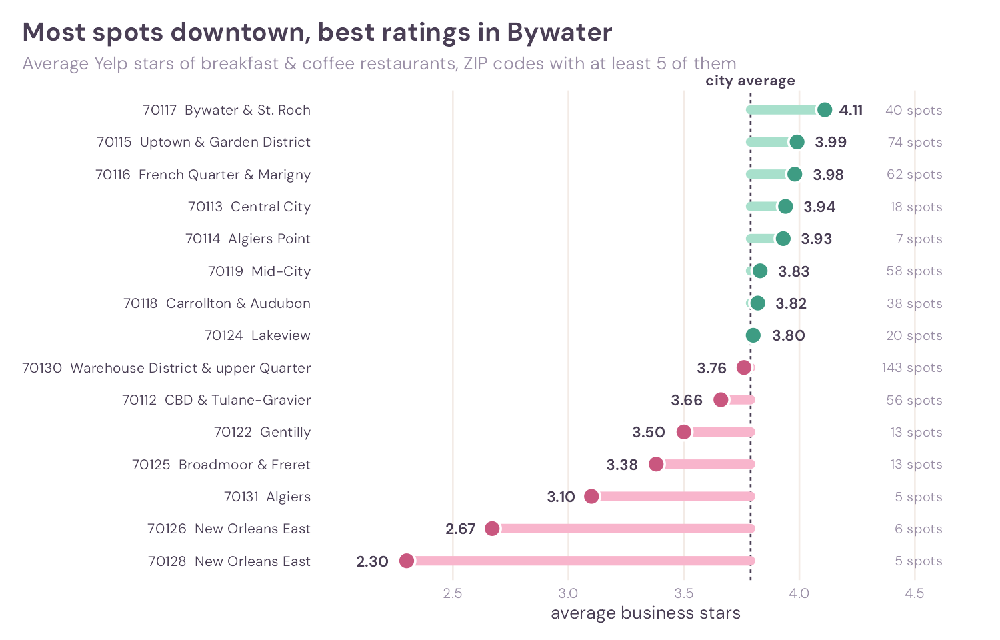
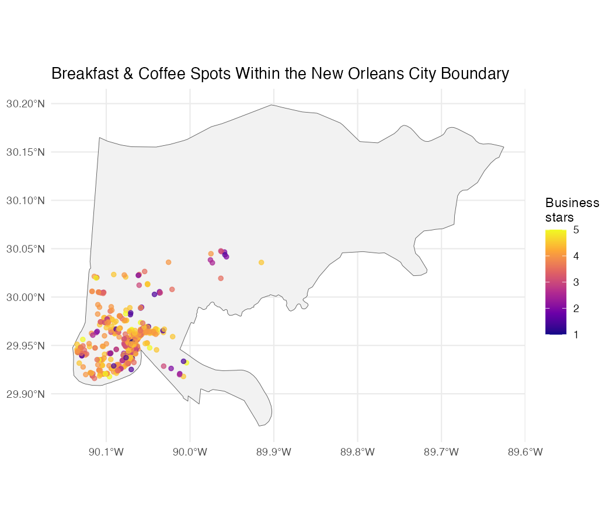
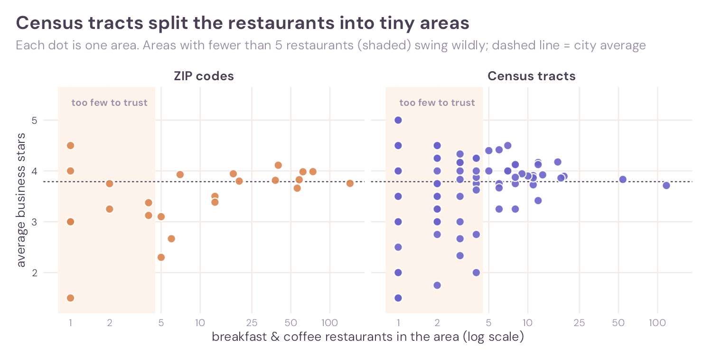
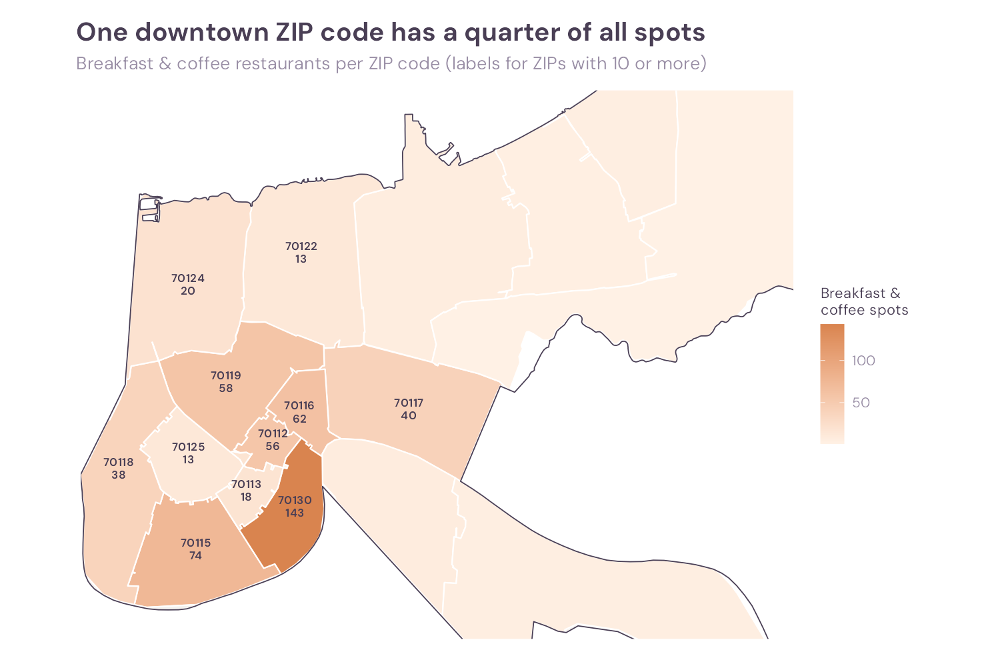

# Where’s the Best Breakfast in New Orleans?


*Math 167R · Project 2 · Yelp Open Dataset · 575 breakfast & coffee
restaurants · 159,552 reviews · work in progress through Step 6*

> **The answer so far:** downtown ZIP **70130** has by far the most
> breakfast & coffee spots (**143**), but not the best ones. The
> highest-rated ZIP codes are **70117** (Bywater & St. Roch, **4.11**
> stars) and **70115** (Uptown & Garden District, **3.99**).



## What this project is about

New Orleans is famous for its breakfast: beignets, brunch and chicory
coffee. But if you only have one morning, **where should you go?**

This project uses the Yelp Open Dataset to answer one question:

> **Where can someone find the best breakfast and coffee in New Orleans,
> and which ZIP code is best for finding it?**

“Best” will combine star ratings, how many reviews a place has, and
(in Step 7) a reviewer-adjusted score that corrects for people who give
everything five stars.

## Key findings so far

**1. Downtown has the most spots, not the best ones.** ZIP 70130 (the
Warehouse District, CBD edge and upper French Quarter) has 143
breakfast & coffee restaurants, a quarter of the total. Its average
rating (3.76) sits just below the city average (3.79).

**2. The best-rated areas are just outside downtown.** Bywater &
St. Roch (70117, 4.11 stars, 40 spots), Uptown & the Garden District
(70115, 3.99, 74 spots) and the French Quarter & Marigny (70116, 3.98,
62 spots) lead the ZIP codes with enough restaurants to compare.

**3. ZIP codes beat census tracts for this question.** Census tracts
split the same restaurants so finely that **75 of 103 tracts** have
fewer than 5 breakfast spots, so one or two restaurants decide the
“average”. Only 9 of 24 ZIP codes are that small.

**4. Yelp’s “New Orleans” is a little bigger than the city.** 11
restaurants labelled `New Orleans` are actually in nearby Jefferson
Parish towns such as Metairie and Harahan.

## The data and how the large files were handled

The project uses two files from the [Yelp Open
Dataset](https://business.yelp.com/data/resources/open-dataset/): the
business file (113 MB, 150,346 businesses) and the review file
(**5.1 GB, 6,990,280 reviews**). The review file is too big to load into
memory in one go, so:

- **Streaming import.** Both files are read with `jsonlite::stream_in()`
  100,000 records at a time. Each batch is cut down to the needed
  columns and to New Orleans restaurants before the next batch is read,
  so the full 5 GB file never sits in memory. Scanning all 7 million
  reviews took about 6 minutes.
- **Only what’s needed.** Only the business and review files are pulled
  out of the Yelp archive.
- **Small, compressed outputs.** Results are saved as `xz`-compressed
  `.rds` files. Review text is stored separately because it makes up
  most of the size: the review table without text is 15 MB, the text
  alone 71 MB.
- **Raw files stay local.** The raw JSON files are listed in
  `.gitignore` and are not on GitHub. After the `.rds` files are saved,
  they can be deleted.

Full log of row counts and run times:
[`import_log.txt`](data/new_orleans/import_log.txt).

## Choosing the restaurants

**New Orleans restaurants.** A business counts if `state` is `LA`, its
`city` is “New Orleans”, and its categories include “Restaurants”. That
gives **2,261** restaurants.

**Breakfast & coffee.** The category field was split into one row per
business and category. Four categories describe places you’d go for a
morning meal or a coffee break:

| Category | Restaurants |
|:---|---:|
| Breakfast & Brunch | 367 |
| Coffee & Tea | 208 |
| Cafes | 173 |
| Bakeries | 81 |

These four belong together: they often appear on the **same**
restaurant.

| Category pair | Restaurants with both |
|:---|---:|
| Breakfast & Brunch + Coffee & Tea | 85 |
| Cafes + Coffee & Tea | 75 |
| Breakfast & Brunch + Cafes | 65 |
| Bakeries + Coffee & Tea | 37 |
| Bakeries + Breakfast & Brunch | 32 |
| Bakeries + Cafes | 16 |

**Inclusion rule:** a restaurant qualifies if it has *at least one* of
the four categories. That gives **575 restaurants** in 25 postal ZIP
codes (24 Census ZIP areas), well above the required 10 restaurants in
7 areas.

All category counts:
[`category_counts.csv`](data/new_orleans/category_counts.csv).

## Joining the reviews

Reviews were filtered to the 575 selected restaurants (joined on
`business_id`) before any further analysis, instead of carrying all
476,565 New Orleans restaurant reviews forward. That leaves **159,552
reviews**.

## Checking the city boundary

Yelp’s `city` field is just text typed by the business. To check it,
each restaurant’s latitude and longitude were matched to the official
city boundaries from the U.S. Census (`tigris::places()`):

| Yelp city | Official place | Restaurants |
|:---|:---|---:|
| New Orleans | New Orleans | 564 |
| New Orleans | Elmwood | 2 |
| New Orleans | Harahan | 2 |
| New Orleans | Jefferson | 2 |
| New Orleans | Metairie | 2 |
| New Orleans | Terrytown | 2 |
| New Orleans | Kenner | 1 |

The 11 mismatches are restaurants with a New Orleans mailing address
that sit just outside the city limits. They are real nearby options, so
they stay in the analysis.



## Choosing a geographic system

To compare areas, the city has to be divided up somehow. Two systems
were tested: **ZIP Code Tabulation Areas** (the Census version of ZIP
codes) and **census tracts**. Each restaurant was assigned to an area
with a spatial join (`st_within`).

| Geographic system | Areas | Restaurants assigned | Unmatched | Smallest area | Largest area | Median per area | Areas with < 5 |
|:---|---:|---:|---:|---:|---:|---:|---:|
| ZIP codes | 24 | 575 | 0 | 1 | 143 | 6.5 | 9 (38%) |
| Census tracts | 103 | 564 | 11 | 1 | 117 | 2 | 75 (73%) |

The 11 unmatched tract restaurants are the same 11 that fall outside
the city limits. Only Orleans Parish tracts were loaded, so they have no
tract to land in.



**The choice: ZIP codes.**

- **Enough restaurants to compare.** Most census tracts hold only one or
  two breakfast spots, so their averages swing from 1.5 to 5 stars
  based on a single restaurant. ZIP codes pool enough restaurants for
  the averages to mean something.
- **Easy to understand.** Anyone knows their ZIP code. Nobody knows
  their census tract number.
- **Nothing left out.** Every restaurant was matched to a ZIP code.

**What ZIP codes hide.** ZIP codes are postal areas, not neighbourhoods,
and they vary a lot in size. 70130 alone covers the Warehouse District
and part of the French Quarter, so a great café and a tourist trap can
share one average. The 9 ZIP codes with fewer than 5 breakfast spots
(17 restaurants in total) are mapped but not ranked.



**ZIP codes with at least 5 breakfast & coffee restaurants:**

| ZIP | Main neighbourhoods | Restaurants | Average stars |
|:---|:---|---:|---:|
| 70130 | Warehouse District & upper French Quarter | 143 | 3.76 |
| 70115 | Uptown & Garden District | 74 | 3.99 |
| 70116 | French Quarter & Marigny | 62 | 3.98 |
| 70119 | Mid-City | 58 | 3.83 |
| 70112 | CBD & Tulane-Gravier | 56 | 3.66 |
| 70117 | Bywater & St. Roch | 40 | **4.11** |
| 70118 | Carrollton & Audubon | 38 | 3.82 |
| 70124 | Lakeview | 20 | 3.80 |
| 70113 | Central City | 18 | 3.94 |
| 70122 | Gentilly | 13 | 3.50 |
| 70125 | Broadmoor & Freret | 13 | 3.38 |
| 70114 | Algiers Point | 7 | 3.93 |
| 70126 | New Orleans East | 6 | 2.67 |
| 70128 | New Orleans East | 5 | 2.30 |
| 70131 | Algiers | 5 | 3.10 |

## Still to come

- **Step 7:** compare ratings from all reviewers with a reviewer-adjusted
  score, to see whether the best ZIP codes stay on top once generous and
  harsh reviewers are accounted for.
- The final **top 10 restaurants** and a map showing where they are.
- **AI prompts** used in the project, with examples of re-prompting.

## Repository contents

| File | What’s inside |
|:---|:---|
| [`R/import.R`](R/import.R) | Streams the Yelp JSON files, filters to New Orleans restaurants, saves `.rds` |
| [`R/clean.R`](R/clean.R) | Category counts, co-occurrence, inclusion rule, review join |
| [`R/analysis.R`](R/analysis.R) | City-boundary check and the ZIP vs. tract spatial joins |
| [`R/compare_systems.R`](R/compare_systems.R) | Area-size comparison, ZIP ratings table, headline chart |
| [`R/theme.R`](R/theme.R) | Shared plot style |
| [`data/new_orleans/`](data/new_orleans/) | Small summary tables (`.csv`, `.rds`) and the import log |
| [`figures/`](figures/) | Every chart and map in this README |

### Reproducing the results

1. Download the **JSON** version of the [Yelp Open
   Dataset](https://business.yelp.com/data/resources/open-dataset/)
   (`Yelp-JSON.zip`, about 4 GB) and put it in `data/raw/`. No need to
   unzip it.
2. From the project folder, run the scripts in order:

``` bash
Rscript R/import.R            # ~6 minutes; streams the 5 GB review file
Rscript R/clean.R
Rscript R/analysis.R          # downloads Census boundaries with tigris
Rscript R/compare_systems.R
```

Packages: `jsonlite`, `dplyr`, `stringr`, `tidyr`, `sf`, `tigris`,
`ggplot2`, `viridis` (and optionally `ragg`).
