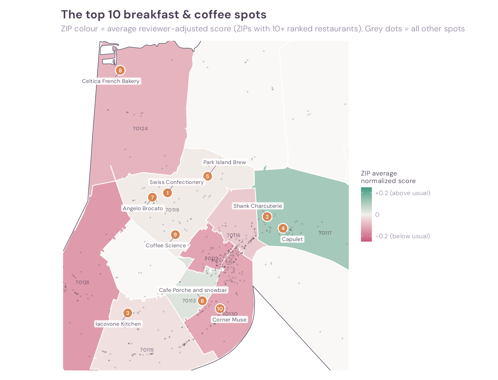
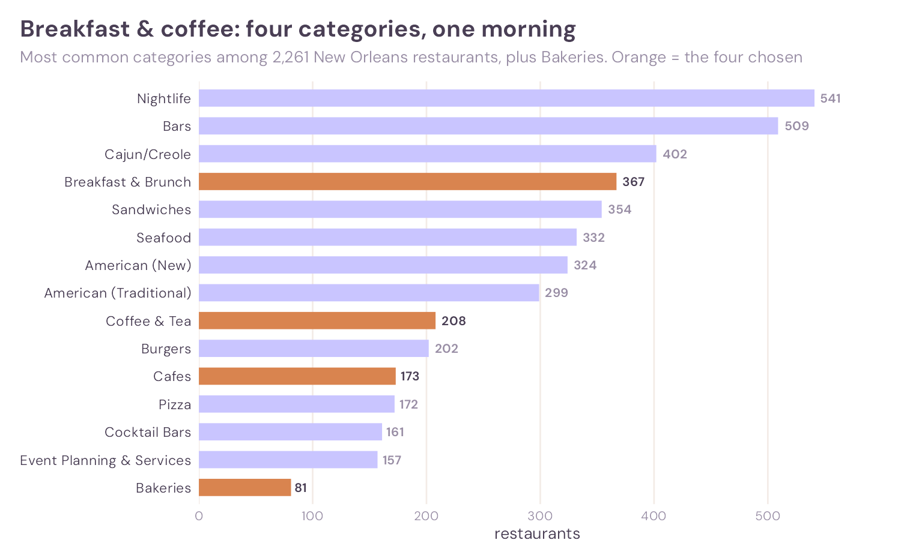
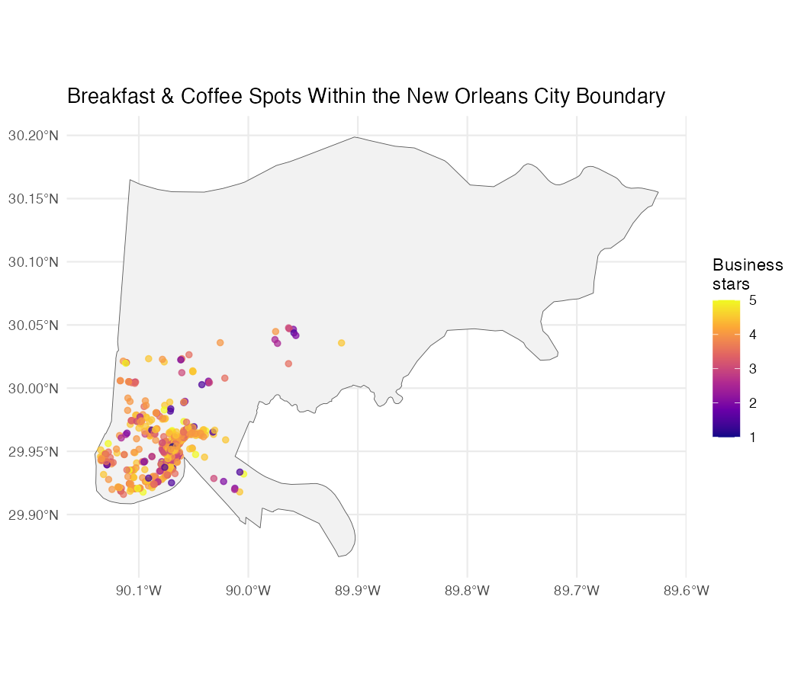
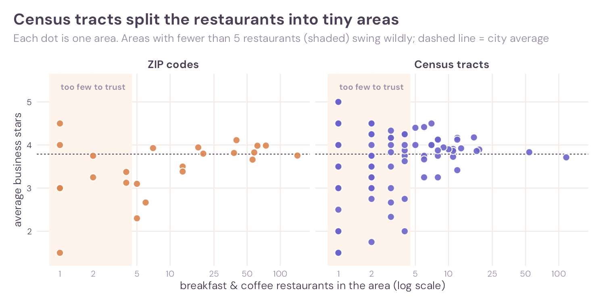
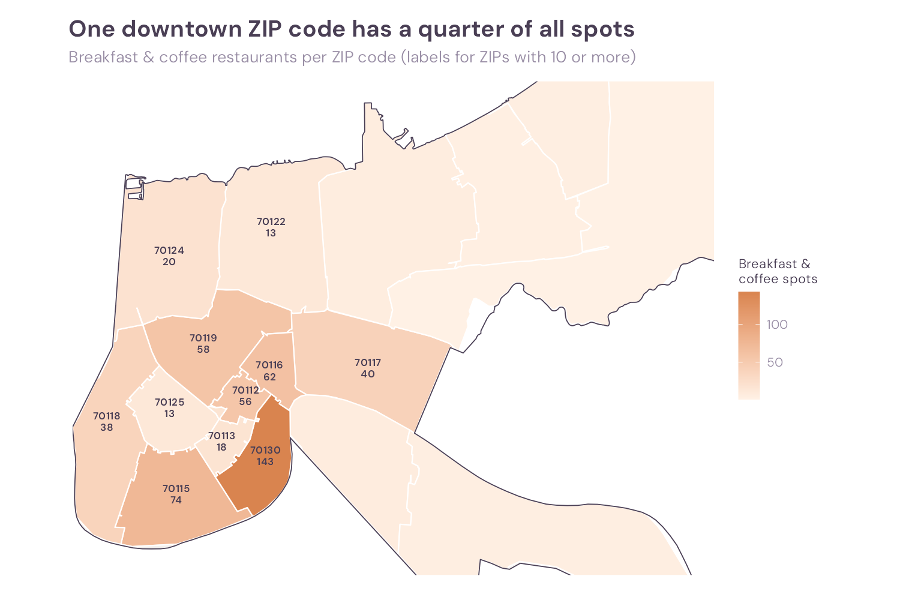
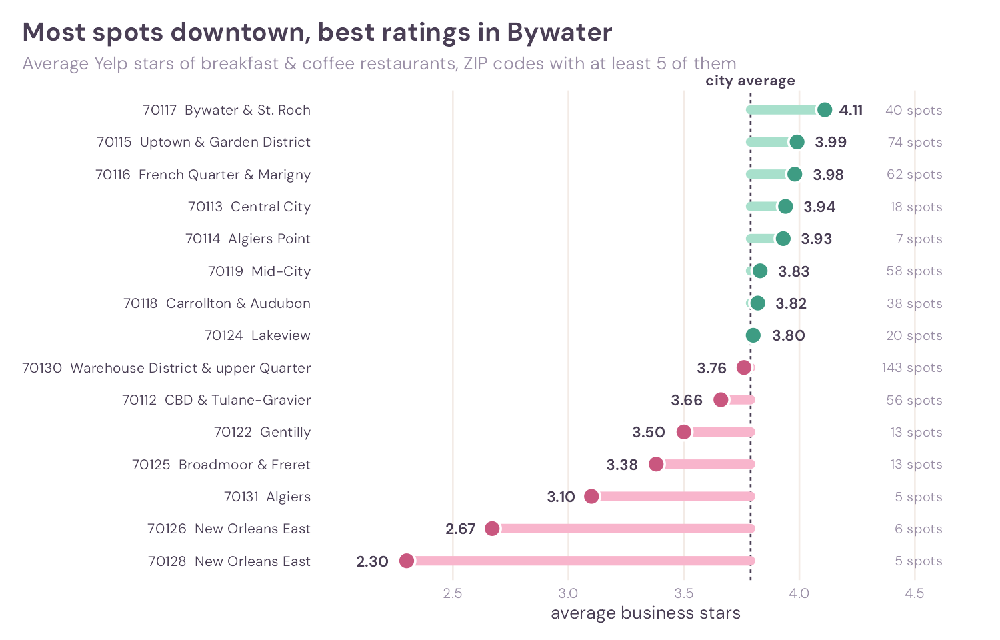
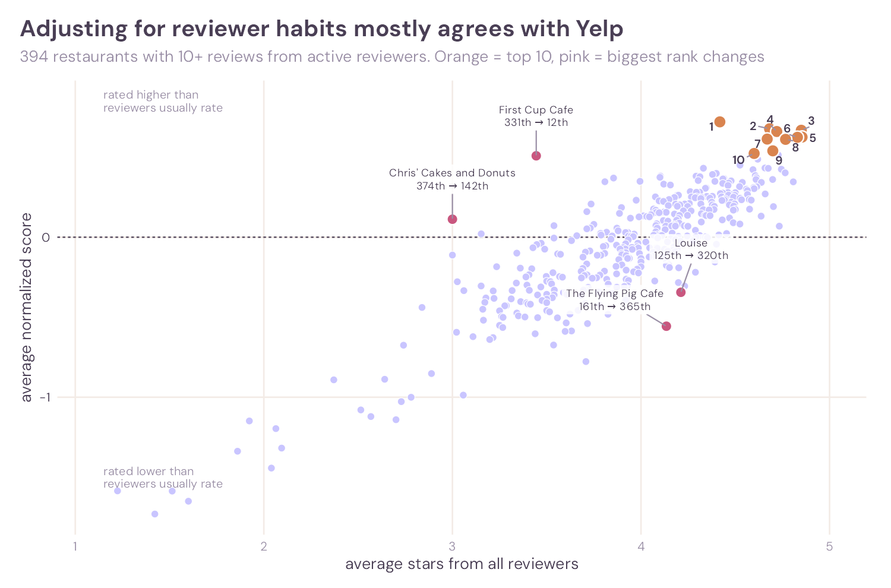
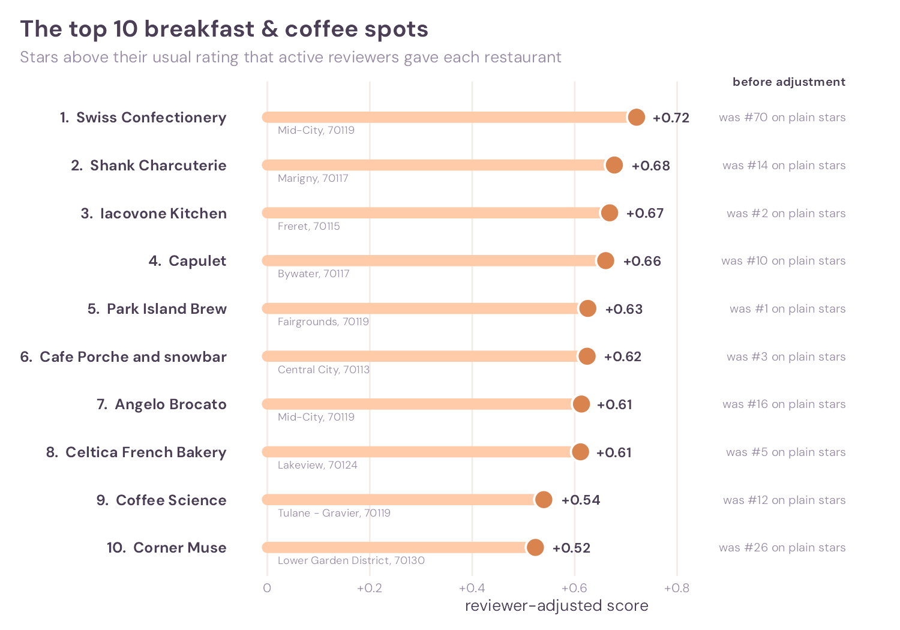

::: {.shortversion}
If you only have one morning in New Orleans, head **just outside downtown**. **Bywater & St. Roch (ZIP 70117)** is the best area overall, **Mid-City (70119)** has the most top-10 spots, and the top-ranked spot is **Swiss Confectionery**. Downtown has the most choice, but not the best choice.
:::

```{=html}
<div class="glance">
<div class="tile"><div class="tile-label">Best area</div><div class="tile-value">Bywater<small>& St. Roch, ZIP 70117</small></div></div>
<div class="tile"><div class="tile-label">Most top-10 spots</div><div class="tile-value">Mid-City<small>4 of the top 10, ZIP 70119</small></div></div>
<div class="tile"><div class="tile-label">Number 1 spot</div><div class="tile-value">Swiss Confectionery<small>Orleans Ave, Mid-City</small></div></div>
<div class="tile"><div class="tile-label">Restaurants studied</div><div class="tile-value">575<small>with 159,552 reviews</small></div></div>
</div>
```

{fig-alt="Map of the top 10 breakfast and coffee restaurants in New Orleans, with ZIP codes coloured by reviewer-adjusted score"}

## The question

New Orleans is famous for its breakfasts: beignets, brunch and chicory coffee. But with one morning to spare, **where should you go?**

> **Where can someone find the best breakfast and coffee in New Orleans, and which area of the city is best for finding it?**

A plain star average has two problems. Some restaurants have only a handful of reviews, and some reviewers give everything five stars while others almost never do. So in this project, “best” means:

1. **Rated well by reviewers who are hard to impress.** Each review is compared with that reviewer’s own usual rating (the *adjusted score*).
2. **Enough evidence.** A restaurant needs at least 10 reviews from active reviewers to be ranked.
3. **For areas:** lots of good options, and restaurants that are rated above reviewers’ usual more often than not.

## The data, and how the huge files were handled

The project uses two files from the [Yelp Open Dataset](https://business.yelp.com/data/resources/open-dataset/): the **business file** (113 MB, 150,346 businesses) and the **review file** (**5.1 GB, 6,990,280 reviews**, from 2005 to January 2022).

::: {.plain}
The review file is bigger than a laptop’s memory can comfortably hold. So instead of opening it all at once, the code reads it **100,000 reviews at a time**, keeps only the reviews of New Orleans restaurants, and throws the rest away before reading the next batch.
:::

- **Streaming import.** Both files are read with `jsonlite::stream_in()` and a handler function. Each batch is cut down to the needed columns before the next is read. Scanning all 7 million reviews took about **6 minutes**.
- **Only what’s needed.** Only the business and review files are pulled out of the Yelp archive.
- **Small, compressed outputs.** Results are saved as `xz`-compressed `.rds` files. Review text is stored separately: the review table without text is 15 MB, the text alone 71 MB.
- **Raw files stay local.** The raw JSON files are several gigabytes, more than GitHub allows, so they are listed in `.gitignore` and can be deleted once the `.rds` files are saved.

```{r}
#| file: R/import.R
#| code-summary: "Show the code: R/import.R"
```

## Choosing the restaurants

**New Orleans restaurants.** A business counts if `state` is `LA`, its `city` is “New Orleans”, and its categories include “Restaurants”. That gives **2,261 restaurants**.

**Breakfast & coffee.** Four categories describe places you’d go for a morning meal or a coffee break: *Breakfast & Brunch*, *Coffee & Tea*, *Cafes* and *Bakeries*.

{fig-alt="Bar chart of the most common restaurant categories, with the four breakfast and coffee categories highlighted"}

These four belong together because they often appear on the **same** restaurant:

| Category pair | Restaurants with both |
|:---|---:|
| Breakfast & Brunch + Coffee & Tea | 85 |
| Cafes + Coffee & Tea | 75 |
| Breakfast & Brunch + Cafes | 65 |
| Bakeries + Coffee & Tea | 37 |
| Bakeries + Breakfast & Brunch | 32 |
| Bakeries + Cafes | 16 |

::: {.plain}
A restaurant is included if it has **at least one** of the four categories. That gives **575 restaurants** spread over 24 ZIP code areas, far more than the required 10 restaurants in 7 areas. Their **159,552 reviews**, from 97,950 different reviewers, were pulled out before any further analysis.
:::

```{r}
#| file: R/clean.R
#| code-summary: "Show the code: R/clean.R"
```

## Checking the city boundary

Yelp’s `city` field is just text typed by the business. To check it, each restaurant’s latitude and longitude were matched to the official city boundary from the U.S. Census with a spatial join.

| Yelp city | Official place | Restaurants |
|:---|:---|---:|
| New Orleans | New Orleans | 564 |
| New Orleans | Elmwood | 2 |
| New Orleans | Harahan | 2 |
| New Orleans | Jefferson | 2 |
| New Orleans | Metairie | 2 |
| New Orleans | Terrytown | 2 |
| New Orleans | Kenner | 1 |

::: {.plain}
11 restaurants have a New Orleans mailing address but sit just outside the city limits, in Jefferson Parish. They are real nearby options, so they stay in.
:::

{fig-alt="Map of breakfast and coffee restaurants inside the New Orleans city boundary, coloured by Yelp stars"}

```{r}
#| file: R/analysis.R
#| code-summary: "Show the code: R/analysis.R"
```

## Choosing a way to divide the city

To compare areas, the city has to be divided up somehow. Three systems were tested:

- **ZIP Code Tabulation Areas**, the Census version of ZIP codes;
- **Neighborhood Statistical Areas**, the City of New Orleans’ own planning neighbourhoods;
- **Census tracts**, statistical areas built for population data.

| System | Areas with a restaurant | Assigned | Unmatched | Smallest | Largest | Median per area | Areas with < 5 |
|:---|---:|---:|---:|---:|---:|---:|---:|
| ZIP codes | 24 | 575 | 0 | 1 | 143 | 6.5 | 9 (38%) |
| Neighbourhoods | 54 | 564 | 11 | 1 | 119 | 4 | 28 (52%) |
| Census tracts | 103 | 564 | 11 | 1 | 117 | 2 | 75 (73%) |

{fig-alt="Scatter plots of restaurants per area against average rating for ZIP codes, neighbourhoods and census tracts"}

::: {.plain}
The smaller the areas, the fewer restaurants each one holds, and the more one restaurant can swing the average. Three out of four census tracts have fewer than 5 breakfast spots.
:::

::: {.decision}
**The choice: ZIP codes**

enough restaurants per area · easy to understand · every restaurant matched
:::

- **Enough restaurants to compare.** ZIP codes pool enough restaurants for the averages to mean something.
- **Easy to understand.** Anyone knows a ZIP code. Few people know their census tract number.
- **Nothing left out.** Every restaurant was matched to a ZIP code, including the 11 just outside the city.

**What ZIP codes hide.** ZIP codes are postal areas, not neighbourhoods. 70130 alone covers the Warehouse District and part of the French Quarter, so a great café and a tourist trap share one average. The 9 ZIP codes with fewer than 5 breakfast spots are mapped but not ranked.

{fig-alt="Map of the number of breakfast and coffee restaurants in each ZIP code"}

{fig-alt="Average Yelp stars by ZIP code compared with the city average"}

```{r}
#| file: R/neighborhoods.R
#| code-summary: "Show the code: R/neighborhoods.R"
```

```{r}
#| file: R/compare_systems.R
#| code-summary: "Show the code: R/compare_systems.R"
```

## Adjusting for reviewer habits

Some reviewers give almost every restaurant five stars; others rarely do. A 4-star review means more from a tough reviewer than from an easy one.

::: {.plain}
For each reviewer, work out their **usual rating**. Then score every review as *stars given minus that reviewer’s usual*. A reviewer who usually gives 3 stars and gives a place 4 adds **+1**. A reviewer who usually gives 5 and gives 4 adds **−1**. A restaurant’s adjusted score is the average of these.
:::

**Who counts as an active reviewer?** A usual rating only means something if the reviewer has rated enough places. Reviewers with at least **5 breakfast & coffee reviews** were kept:

| Minimum reviews | Reviewers kept | Share of reviewers | Reviews kept | Share of reviews | Restaurants ranked |
|---:|---:|---:|---:|---:|---:|
| 3 | 11,531 | 11.8% | 57,617 | 36.1% | 448 |
| **5** | **3,416** | **3.5%** | **30,918** | **19.4%** | **394** |
| 10 | 784 | 0.8% | 14,919 | 9.4% | 325 |

Only 3.5% of reviewers qualify, but they wrote almost a fifth of all reviews. A higher threshold gives each reviewer a better baseline, but leaves fewer restaurants to rank.

**Mean or median?** The **mean** was used as each reviewer’s usual rating. Ratings are whole stars, so with a median baseline **49%** of reviews get an adjusted score of exactly 0, throwing away most of the information. With the mean, only 5% do. The typical active reviewer averages 4.0 stars, but the range is wide: 2.9 at the 5th percentile, 4.8 at the 95th.

{fig-alt="Scatter plot of plain Yelp averages against reviewer-adjusted scores, with the top 10 and the biggest rank changes highlighted"}

Ranks before and after adjustment are strongly related (rank correlation **0.83**), but a few restaurants move hundreds of places:

| Restaurant | ZIP | Stars (all reviewers) | Stars (active reviewers) | Rank before | Rank after |
|:---|:---|---:|---:|---:|---:|
| First Cup Cafe | 70125 | 3.44 | 4.47 | 331st | **12th** |
| Chris’ Cakes and Donuts | 70128 | 3.00 | 3.82 | 374th | 142nd |
| Rare Form | 70116 | 3.85 | 4.27 | 251st | 29th |
| Le Citron Bistro | 70130 | 3.81 | 4.10 | 260th | 38th |
| The Flying Pig Cafe | 70115 | 4.13 | 3.30 | 161st | **365th** |
| Louise | 70117 | 4.21 | 3.83 | 125th | 320th |
| Wakin’ Bakin’ | 70115 | 4.23 | 3.79 | 121st | 307th |
| Streetcar Cafe | 70130 | 4.39 | 4.19 | 74th | 259th |

::: {.plain}
The moves have two causes. **Reviewer behaviour:** First Cup Cafe’s active reviewers rate it a full star higher than casual reviewers do. **Small samples:** most of these restaurants have only 10 to 25 active-reviewer reviews, so a few reviews move them a long way.
:::

```{r}
#| file: R/reviewers.R
#| code-summary: "Show the code: R/reviewers.R"
```

## The answer

{fig-alt="Lollipop chart of the top 10 restaurants by reviewer-adjusted score"}

| Rank | Restaurant | Neighbourhood (ZIP) | Yelp reviews | Average stars | Adjusted score | Rank on plain stars |
|---:|:---|:---|---:|---:|---:|---:|
| 1 | Swiss Confectionery | Mid-City (70119) | 55 | 4.42 | +0.72 | 70th |
| 2 | Shank Charcuterie | Marigny (70117) | 44 | 4.68 | +0.68 | 14th |
| 3 | Iacovone Kitchen | Freret (70115) | 40 | 4.85 | +0.67 | 2nd |
| 4 | Capulet | Bywater (70117) | 50 | 4.72 | +0.66 | 10th |
| 5 | Park Island Brew | Fairgrounds (70119) | 48 | 4.85 | +0.63 | 1st |
| 6 | Cafe Porche and snowbar | Central City (70113) | 176 | 4.83 | +0.62 | 3rd |
| 7 | Angelo Brocato | Mid-City (70119) | 650 | 4.67 | +0.61 | 16th |
| 8 | Celtica French Bakery | Lakeview (70124) | 30 | 4.77 | +0.61 | 5th |
| 9 | Coffee Science | Tulane-Gravier (70119) | 93 | 4.70 | +0.54 | 12th |
| 10 | Corner Muse | Lower Garden District (70130) | 55 | 4.60 | +0.52 | 26th |

**Which area is best?** ZIP codes with at least 10 ranked restaurants:

| ZIP | Main neighbourhoods | Ranked | Above reviewers’ usual | In top 10 | In top 50 | Average adjusted score |
|:---|:---|---:|---:|---:|---:|---:|
| 70117 | Bywater & St. Roch | 30 | **60%** | 2 | 8 | **+0.11** |
| 70113 | Central City | 10 | 70% | 1 | 2 | +0.03 |
| 70119 | Mid-City | 43 | 53% | **4** | 8 | −0.01 |
| 70115 | Uptown & Garden District | 62 | 53% | 1 | 7 | −0.02 |
| 70116 | French Quarter & Marigny | 39 | 54% | 0 | 4 | −0.06 |
| 70124 | Lakeview | 17 | 41% | 1 | 1 | −0.10 |
| 70130 | Warehouse District & upper French Quarter | 98 | 44% | 1 | **9** | −0.12 |
| 70112 | CBD & Tulane-Gravier | 33 | 42% | 0 | 2 | −0.13 |
| 70118 | Carrollton & Audubon | 31 | 45% | 0 | 4 | −0.14 |

::: {.decision}
**Best area: Bywater & St. Roch (70117)**

highest Yelp stars of any ZIP code with 5+ spots (4.11) · top adjusted score (+0.11) · 60% of its restaurants beat their reviewers’ usual
:::

- **Mid-City (70119)** is where the top picks are: 4 of the top 10.
- **Downtown (70130)** has the most choice (143 spots, a quarter of the total) and 9 of the top 50, but its restaurants score *below* their reviewers’ usual on average.
- 70113 has the highest share above usual, but only 10 ranked restaurants, so 70117 is the better-supported answer.

```{r}
#| file: R/maps.R
#| code-summary: "Show the code: R/maps.R"
```

```{r}
#| file: R/charts.R
#| code-summary: "Show the code: R/charts.R"
```

## How sure is the top 10?

Changing one choice at a time:

| Version | Restaurants still in the top 10 |
|:---|---:|
| Reviewers with 3+ reviews count as active | 6 of 10 |
| Reviewers with 10+ reviews count as active | 6 of 10 |
| Median baseline instead of mean | 8 of 10 |
| Restaurants need 20+ active-reviewer reviews | 3 of 10 |
| Plain Yelp average (no adjustment) | 5 of 10 |

::: {.plain}
The exact list is sensitive, mostly because many top restaurants are small, with 10 to 20 active-reviewer reviews. The **area** answer is steadier: in every adjusted version, Mid-City (70119) and Bywater & Marigny (70117) together hold at least half of the top 10.
:::

## Limitations

- **The data stops in January 2022.** Some restaurants may have closed or changed since then.
- **Yelp categories are broad.** “Cafes” and “Coffee & Tea” also tag gelato shops (Angelo Brocato) and sandwich counters (Shank Charcuterie), so a few top-10 spots are not classic breakfast places.
- **Active reviewers are a small group.** The adjusted score rests on 3.5% of reviewers, whose tastes may differ from a typical visitor’s.
- **Small samples.** Restaurants need only 10 active-reviewer reviews to be ranked, so the exact order could change with more data.
- **ZIP codes are not neighbourhoods.** A ZIP code average mixes very different streets.

## Conclusion

For breakfast and coffee in New Orleans, the best area is **just outside downtown**. Bywater & St. Roch (70117) has the highest ratings on both measures, and Mid-City (70119) holds the most top-10 spots. Downtown 70130 has the most options, but its restaurants are, on average, rated slightly below what their reviewers usually give.

Adjusting for reviewer habits mostly confirms Yelp’s ratings, but it lifts a few places loved by active reviewers (First Cup Cafe) and drops a few that only casual reviewers rate highly.

::: {.plain}
A high star average from hundreds of easy reviewers is weaker evidence than a good score from people who are hard to impress.
:::
